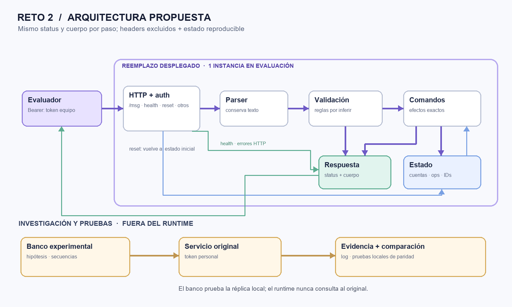

# Micrositio de presentación — La caja negra

Sitio estático bilingüe para explicar el Reto 2, mostrar evidencia V1/V2 y presentar cómo se trabajó. La experiencia comienza en inglés y permite cambiar a español desde el selector EN/ES. Incluye un recorrido narrado de la landing page, ocho diapositivas navegables y un guion de expositor separado, oculto al proyectar o imprimir.

## Arquitectura

El dibujo separa el servicio que se entrega del banco empleado para investigar el original. Las cajas de lectura, validación y comandos representan responsabilidades para explicar el flujo, no archivos uno-a-uno ni el diseño interno del proveedor. El servicio entregado no consulta el original.

## Método de trabajo

- Se usó un banco propio, serial y con pausas; se guardaron los intentos, incluidos errores y respuestas incompletas.
- Las pruebas empezaban desde un estado conocido, cambiaban una variable y comparaban secuencias entre versiones.
- El generador de entradas inusuales preparaba candidatos; una persona decidía qué enviar. No automatizaba golpes masivos al servicio.
- Obsidian conservó fuentes originales, notas enlazadas y un historial append-only para recuperar contexto en otras sesiones.
- Se definieron seis roles y sus arneses. Son contratos de trabajo, no seis agentes autónomos con permisos aplicados por software. Se intentó una tanda de diez agentes paralelos, pero el límite interno no la permitió; hubo revisiones independientes puntuales.
- El trabajo se iteró en Codex con modelos Luna y Sol, según el registro del autor.

Como referencias de método se consultaron [pruebas de secuencias con estado](https://hypothesis.readthedocs.io/en/latest/stateful.html), [pruebas de contrato](https://docs.pact.io/implementation_guides/go/docs/consumer) y [RFC 6585 para 429 y Retry-After](https://datatracker.ietf.org/doc/rfc6585/). Se tomaron ideas; no se integraron esos productos para descubrir el servicio.

## Controles y alcance

- El sitio es de solo lectura y no llama al original ni al entrypoint.
- El archivo `data/evidence.json` es una muestra curada de ejemplos públicos y filas citadas del log canónico.
- La copia local `experimentos.jsonl` contiene el log canónico hasta el ID 868 (corte 10-oct-2026 20:30 Bolivia / 00:30 UTC). El corte publicado anteriormente en el repositorio del reto llega al ID 832; ambos cortes no deben confundirse.
- Los hallazgos distinguen dos causas confirmadas de la tercera anunciada pero no aislada.
- No guardar tokens, `.env`, capturas con credenciales ni respuestas de tests ocultos aquí.

## Ejecutar local

Sirve esta carpeta con cualquier servidor estático y abre su `index.html`. No hace falta Node en runtime ni construir assets.

## Despliegue

Proyecto Vercel: `caja-negra-reto-2`. Raíz estática; sin dependencias o variables de entorno. La página permite descargar el diagrama, la especificación, el guion para recorrer la landing, el guion de diapositivas y el log de 868 filas. La sección `Demo Day` enlaza de forma visible al video público de presentación en YouTube.
